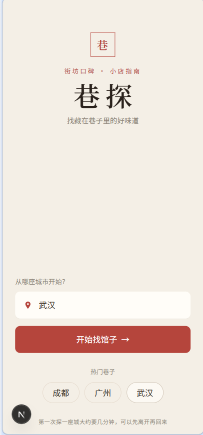
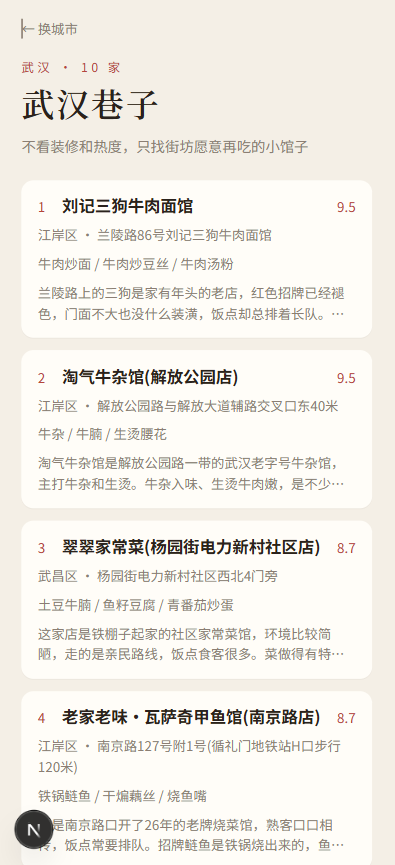
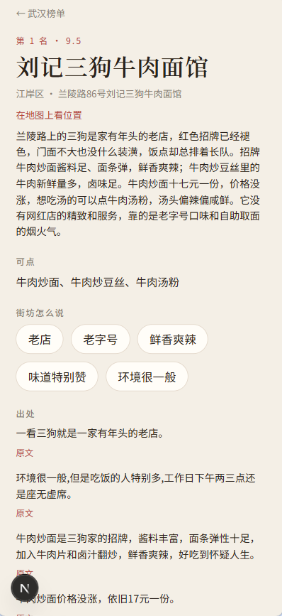

# 巷探

找藏在巷子里的好味道。

输入一座城市，巷探会从公开网页里搜本地口碑，丢掉网红店和连锁店，核对地图位置，再给出一份带证据的小馆子榜单。不看装修和热度，只找街坊愿意再吃的店。

首次探一座城大约一两分钟；已经出过榜的城市直接读本地结果。

## 界面

选一座城，或点热门巷子。



榜上有地址、推荐菜、上榜理由和分数。



点进一家店能看到口碑摘要、街坊怎么说，以及能点回去的原文出处。



## 怎么跑

需要 Python 3.12、Node.js，以及博查、DeepSeek、高德的 API Key。复制 `.env.example` 为 `.env` 后填入密钥。

```powershell
uv sync
uv run alleyfinder-api
```

另开一个终端：

```powershell
cd web
npm install
npm run dev
```

打开 [http://localhost:3000](http://localhost:3000)。前端 `/api` 会转到 `http://127.0.0.1:8000`。

## 它怎么找店

```
搜索口碑 → 抽取店名 → 高德定位 → 初筛短名单 → 深筛打分出榜
```

同一座城多人同时点，只会跑一条任务；不同城市会并行，外部接口额度会挤在一起。

更多说明见 [docs/PRD.md](docs/PRD.md)、[docs/目录说明.md](docs/目录说明.md)、[docs/流水线速度优化.md](docs/流水线速度优化.md)。
